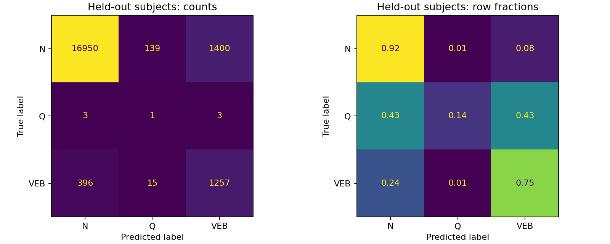
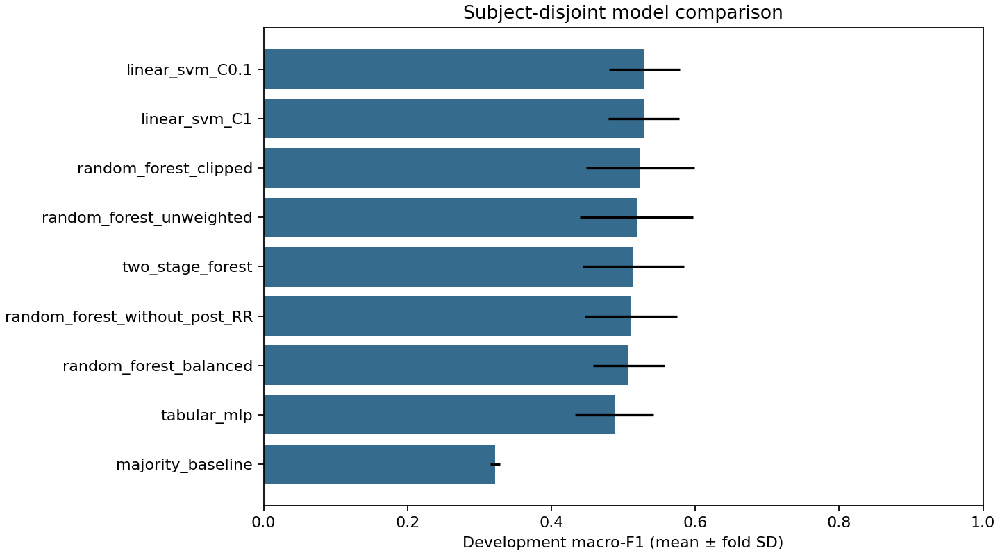

# Measured results

Full-dataset run, seed 42; 120 trees per forest. No sampled-down training dataset was used.

Selected by development CV: **linear_svm_C0.1**.

## Final evaluation on held-out subjects

| Evaluation | Accuracy | Macro-F1 | Macro recall (fixed labels) |
|---|---:|---:|---:|
| Selected model / held-out subjects | 0.9030 | 0.5130 | 0.6044 |
| Majority / held-out subjects | 0.9169 | 0.3189 | 0.3333 |
| Forest / beat-random diagnostic | 0.9968 | 0.6589 | 0.6551 |

The beat-random diagnostic uses a different test population and overlapping subjects; it is not a controlled causal comparison of split methods.

| Held-out class | Precision | Recall | F1 | Support |
|---|---:|---:|---:|---:|
| N | 0.9770 | 0.9168 | 0.9459 | 18489 |
| Q | 0.0065 | 0.1429 | 0.0123 | 7 |
| VEB | 0.4726 | 0.7536 | 0.5809 | 1668 |

## Development comparison

| Candidate | Mean macro-F1 | Fold SD | Mean accuracy |
|---|---:|---:|---:|
| linear_svm_C0.1 | 0.5293 | 0.0492 | 0.9247 |
| linear_svm_C1 | 0.5284 | 0.0492 | 0.9235 |
| random_forest_clipped | 0.5232 | 0.0751 | 0.9416 |
| random_forest_unweighted | 0.5184 | 0.0788 | 0.9374 |
| two_stage_forest | 0.5143 | 0.0705 | 0.9377 |
| random_forest_without_post_RR | 0.5104 | 0.0641 | 0.9373 |
| random_forest_balanced | 0.5075 | 0.0497 | 0.9407 |
| tabular_mlp | 0.4876 | 0.0545 | 0.9140 |
| majority_baseline | 0.3219 | 0.0067 | 0.9346 |

## Interpretation

Class weighting changed forest validation macro-F1 from 0.5184 to 0.5075. Quantile clipping achieved 0.5232, removing post-RR achieved 0.5104, the MLP achieved 0.4876, and the two-stage model achieved 0.5143. These comparisons are descriptive, with no statistical significance claim.

The Q test result uses only 7 examples. The entire table has only 15 Q beats from five records. This cannot establish dependable three-class arrhythmia detection. High overall accuracy primarily reflects the dominant N label.

Some validation folds have no Q examples. Macro-F1 is calculated over the same N/Q/VEB label set in every fold; undefined class scores are zero. Fold standard deviations describe variability and are not confidence intervals. This is one outer held-out partition, with no external validation.

Post-RR observes the next heartbeat. Other extraction windows and label mappings are undocumented. Removing post-RR does not establish streaming suitability. The saved model remains fitted to development subjects only.

## Reproduction

- Input: 97,107 rows; 44 records; 43 subject groups.
- Development: 76,943 rows; test: 20,164 rows.
- Held-out records: 105, 118, 122, 200, 214, 215, 228, 234.
- CSV SHA-256: `0d5f9614bcfa5c09becf9f3cfdda1a6104093d01365a1f252dc7e9bc3b511fe2`.
- Recorded experiment duration: 438.8 seconds (hardware-dependent).
- Package versions: `{"numpy": "2.2.6", "pandas": "2.2.3", "python": "3.12.3", "sklearn": "1.7.1"}`.
- `split_manifest.csv` contains every input row assignment; 201/202 share a subject group.
- `cv_folds.csv` contains individual development fold scores.
- `feature_importance.csv` uses development validation fold 0, three permutation repeats, at most 3,000 rows; it is neither causal nor Q-specific.

Convergence warnings: none recorded.
